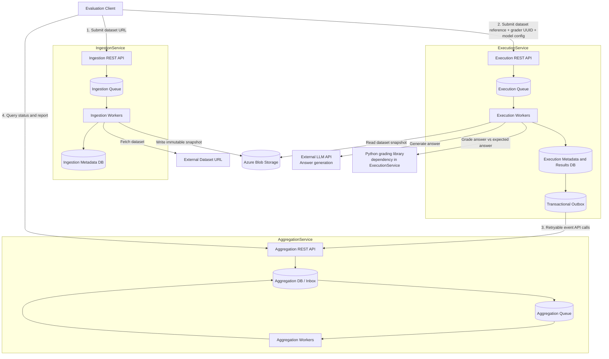
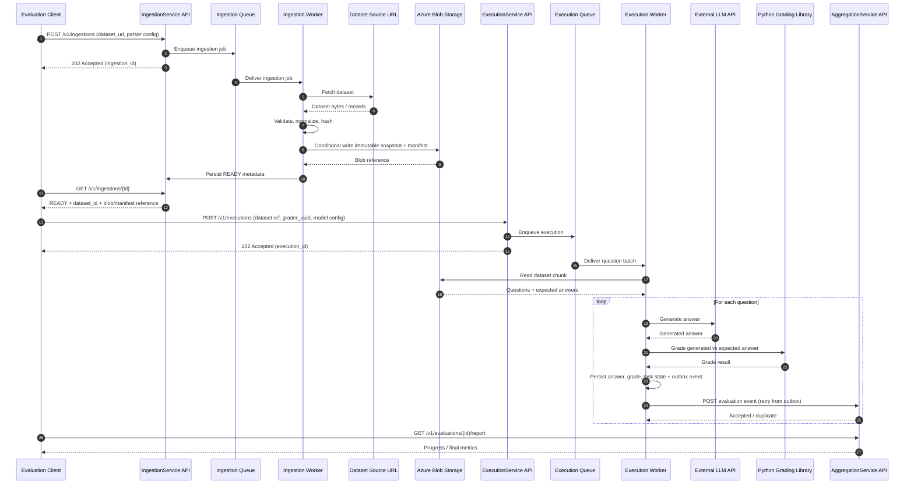
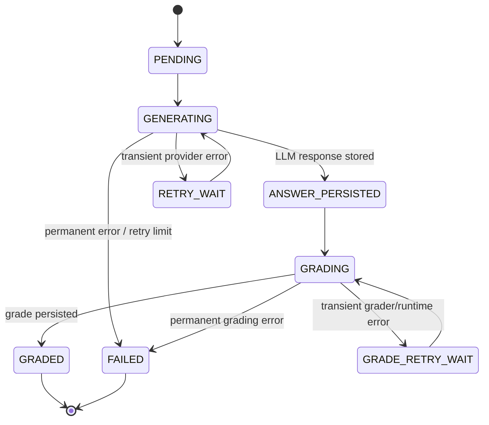
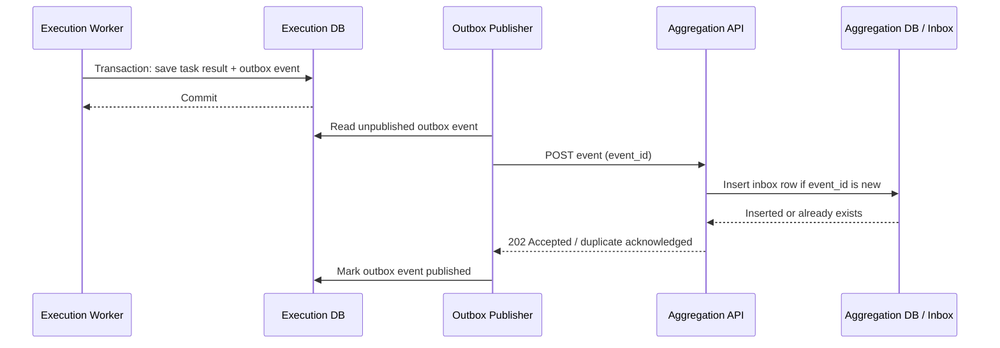

## 1. Problem

Design an asynchronous evaluation platform that accepts a dataset URL (for example, Math500, containing questions and expected answers), generates model answers, grades them using a Python grading library, and aggregates evaluation metrics.

The platform has exactly three internal services:

1. **IngestionService**: fetches, validates, normalizes, and stores immutable dataset snapshots.
2. **ExecutionService**: schedules question-level work, calls an external LLM API, grades answers, and records results.
3. **AggregationService**: consumes execution events and produces progress and final evaluation reports.

External dependencies are not internal services:

- Dataset source URL
- Azure Blob Storage
- External LLM API (answer generation)
- Python grading library, loaded and executed by ExecutionService workers

Each internal service owns its API, database, queue, and workers. Services communicate with one another only through APIs. No service reads another service's database or queue.

## 2. High-level architecture



**Important boundaries**

- The external LLM API is called directly by ExecutionService workers. It is not an internal service.
- Azure Blob Storage is shared managed infrastructure, not a fourth microservice. IngestionService writes snapshots; ExecutionService reads them using its own identity and authorization.
- The Python grading library runs inside the ExecutionService worker process/container. It is not a network service.
- IngestionService does not receive model parameters or the grader UUID. Those are execution concerns.
- The client first obtains a ready dataset reference from IngestionService, then submits that reference to ExecutionService. This keeps the three service boundaries independent.

## 3. End-to-end flow



## 4. Service responsibilities

### 4.1 IngestionService

**Responsibilities**

- Accept dataset URL and dataset parsing/schema configuration.
- Validate URL and defend against SSRF:
  - Allow only approved schemes (normally HTTPS).
  - Block loopback, private, link-local, and cloud metadata IP ranges.
  - Revalidate every redirect target and DNS resolution.
  - Enforce download size, timeout, redirect, and content-type limits.
- Fetch and stream dataset content.
- Parse records and validate required question and expected-answer fields.
- Normalize records into a versioned canonical schema.
- Compute raw-content and normalized-content hashes.
- Persist an immutable snapshot and manifest in Azure Blob Storage.
- Deduplicate equivalent normalized dataset content.
- Persist ingestion metadata and expose status.

**Canonical record example**

```json
{
  "record_id": "math500-000001",
  "question": "What is 2 + 2?",
  "expected_answer": "4"
}
```

**Ingestion request**

```http
POST /v1/ingestions
Idempotency-Key: ingest-request-123
```

```json
{
  "dataset_url": "https://example.com/math500.json",
  "dataset_config": {
    "format": "json",
    "question_field": "question",
    "answer_field": "expected_answer"
  }
}
```

Do not put `model_config` or `grader_uuid` in this request. Ingestion is model- and grader-independent.

**Suggested APIs**

| API | Purpose |
|---|---|
| `POST /v1/ingestions` | Submit an ingestion job; return `202` and an ingestion ID |
| `GET /v1/ingestions/{ingestion_id}` | Read status and dataset reference |
| `GET /v1/ingestions/{ingestion_id}/manifest` | Read manifest metadata |
| `POST /v1/ingestions/{ingestion_id}/cancel` | Request cancellation |

**Ready response example**

```json
{
  "ingestion_id": "ing-123",
  "status": "READY",
  "dataset": {
    "dataset_id": "ds-abc",
    "content_hash": "sha256:abc123",
    "blob_uri": "https://account.blob.core.windows.net/datasets/sha256/abc123/data.jsonl",
    "manifest_uri": "https://account.blob.core.windows.net/datasets/sha256/abc123/manifest.json",
    "record_count": 500,
    "schema_version": "1"
  }
}
```

The blob URI is a private resource reference, not a public URL or bearer credential. ExecutionService reads it with its own managed identity and scoped permissions. If a delegated SAS is required, issue a short-lived, read-only token through a separate controlled mechanism.

**Dataset deduplication**

- Hash normalized content, including the canonical schema/normalization version in the identity.
- Use the content hash as a content identity, not the source URL. The same URL can serve different bytes over time.
- Store raw hash separately for provenance.
- Use a unique metadata constraint on `(tenant_scope, normalized_content_hash, schema_version)` where tenant isolation is required.
- Use conditional blob creation such as `If-None-Match: *` to avoid overwriting an existing immutable object.
- Handle concurrent uploads by allowing one writer to create the blob and having the others resolve the already-created content-addressed object.
- Keep logical dataset IDs and authorization metadata separate from physical blob paths.

### 4.2 ExecutionService

**Responsibilities**

- Accept a ready dataset reference, platform-issued `grader_uuid`, model configuration, execution configuration, and idempotency key.
- Authorize access to the dataset reference and verify its immutable content hash/manifest.
- Resolve `grader_uuid` through a trusted grader registry.
- Pin grader implementation/version and relevant configuration for reproducibility.
- Create question-level or batch-level tasks and enqueue work.
- Read dataset chunks directly from Blob Storage; do not proxy dataset bytes through IngestionService.
- Call the external LLM API for answer generation.
- Run the Python grading library inside the worker environment.
- Persist generated answers, generation attempts, grading results, and task states.
- Publish progress/completion events to AggregationService through its API.

**Execution request**

```http
POST /v1/executions
Idempotency-Key: execution-request-123
```

```json
{
  "dataset": {
    "dataset_id": "ds-abc",
    "blob_uri": "https://account.blob.core.windows.net/datasets/sha256/abc123/data.jsonl",
    "manifest_uri": "https://account.blob.core.windows.net/datasets/sha256/abc123/manifest.json",
    "content_hash": "sha256:abc123"
  },
  "grader_uuid": "platform-issued-grader-uuid",
  "model_config": {
    "model": "model-name",
    "temperature": 0,
    "max_tokens": 2048
  },
  "execution_config": {
    "batch_size": 50,
    "max_concurrency": 20
  }
}
```

In a stricter API design, the client can pass only `dataset_id`; ExecutionService then resolves the authorized blob reference through an ingestion metadata API or a shared dataset-reference contract. If the blob URI is passed directly, treat it as untrusted input: validate account/container allowlists, tenant authorization, object identity, and content hash. Never let a caller use an arbitrary URI to make workers fetch arbitrary network locations.

**Suggested APIs**

| API | Purpose |
|---|---|
| `POST /v1/executions` | Create an execution and return `202` |
| `GET /v1/executions/{execution_id}` | Read execution status |
| `GET /v1/executions/{execution_id}/tasks` | Inspect task-level progress |
| `GET /v1/executions/{execution_id}/results` | Read generated answers and grading results |
| `POST /v1/executions/{execution_id}/cancel` | Request cancellation |
| `POST /v1/executions/{execution_id}/retry` | Retry eligible failed work under explicit policy |

**Worker task lifecycle**



Persist the generated answer before grading. If grading fails transiently, retry grading against the stored answer instead of calling the LLM again. Persist generation attempts separately because model calls may be nondeterministic.

**Grader UUID safety**

- A UUID is an identifier, not executable code.
- Resolve it against a platform-controlled registry.
- Registry metadata should identify an approved package/artifact, immutable version, entry point, resource profile, and configuration schema.
- Do not accept arbitrary import paths, package URLs, Python snippets, or shell commands from the execution request.
- Run untrusted or third-party grader code in a sandbox with CPU/memory/time limits, restricted filesystem, and restricted network access.

### 4.3 AggregationService

**Responsibilities**

- Receive progress and terminal task events from ExecutionService over an API.
- Deduplicate events using a stable `event_id`.
- Persist accepted events in an inbox and enqueue aggregation work.
- Maintain counters and metrics per evaluation/execution.
- Expose progress, final report, and status APIs.
- Finalize only when all expected tasks are terminal, or when cancellation/failure policy says the run is terminal.

**Suggested APIs**

| API | Purpose |
|---|---|
| `POST /v1/evaluations/{evaluation_id}/events` | Accept progress/task events |
| `GET /v1/evaluations/{evaluation_id}` | Read status |
| `GET /v1/evaluations/{evaluation_id}/metrics` | Read current counters |
| `GET /v1/evaluations/{evaluation_id}/report` | Read final report |
| `POST /v1/evaluations/{evaluation_id}/finalize` | Request or perform finalization |

**Event example**

```json
{
  "event_id": "evt-123",
  "evaluation_id": "eval-123",
  "execution_id": "exec-123",
  "event_type": "TASK_GRADED",
  "task_id": "task-001",
  "generation_id": "gen-001",
  "grader_version": "grader-v4",
  "is_correct": true
}
```

Prefer task-level events as the source of truth. AggregationService can derive counts from deduplicated terminal task events, rather than blindly adding worker-supplied cumulative counters that may be repeated or arrive out of order.

**Report example**

```json
{
  "evaluation_id": "eval-123",
  "status": "COMPLETED",
  "total_questions": 500,
  "graded_questions": 500,
  "correct_answers": 425,
  "failed_questions": 0,
  "cancelled_questions": 0,
  "accuracy": 0.85,
  "coverage": 1.0
}
```

Definitions:

- `accuracy = correct_answers / graded_questions`
- `coverage = graded_questions / total_questions`
- Failed or unprocessed tasks are not silently counted as incorrect answers. Report coverage and failures separately.
- Terminal accounting should satisfy `graded + failed + cancelled = total` once the execution is fully terminal.

## 5. Reliability and idempotency

Do not conflate request idempotency, content deduplication, task idempotency, and event deduplication. They solve different failure modes.

### 5.1 API request idempotency

For ingestion and execution creation:

- Scope key by tenant: `(tenant_id, idempotency_key)`.
- Persist the semantic request hash, created resource ID, and original response/status.
- Same key + same request hash: return the original resource/result.
- Same key + different request hash: return `409 Conflict`.
- Ensure resource creation and queue publication cannot be separated by a crash. Use a transactional outbox or a database/queue transaction where supported.

### 5.2 Content deduplication

- Key on normalized dataset content hash plus normalization/schema version and tenant scope as appropriate.
- Different ingestion requests can resolve to the same immutable physical blob where policy permits.
- URL is provenance, not content identity.
- Conditional blob writes and a unique metadata constraint handle concurrent ingestion races.

### 5.3 Task-level idempotency

- Stable task identity: `(execution_id, record_id)` or `(execution_id, question_id)`.
- Use durable task state and conditional state transitions/leases so duplicate queue deliveries do not create duplicate committed results.
- Persist LLM generation attempts independently.
- Once an answer is persisted, retries should resume at grading.
- A grading result identity can be `(generation_id, grader_version, grader_config_hash)`.

**Exactly-once caveat:** Do not promise exactly-once LLM invocation. A provider may have completed a request even if the worker times out before receiving or persisting the response. Use provider idempotency keys if supported, record attempt IDs, and make result commits idempotent. The practical goal is effectively-once business state, not exactly-once external side effects.

### 5.4 Event delivery

Use a transactional outbox in ExecutionService:

1. Persist task result/state and an outbox event in the same database transaction.
2. An outbox publisher calls AggregationService's event API.
3. Retry transient failures with backoff until accepted.
4. AggregationService stores the event in a deduplicating inbox keyed by `event_id`.
5. Inbox insertion and aggregation state changes must be transactionally coordinated.

This gives at-least-once delivery with idempotent processing; it is not exactly-once network delivery.



### 5.5 Execution fingerprint is not an idempotency key

A reproducibility fingerprint can be computed as:

`F = H(dataset_snapshot_hash, model_config, model_version, grader_uuid, grader_version, execution_config)`

It identifies equivalent execution configuration. Do not automatically deduplicate executions by this fingerprint: users may intentionally run the same configuration multiple times as separate experiments. Use the API idempotency key to identify a retried create request.

## 6. Queueing, backpressure, and scaling

Each service owns its durable queue. A queue absorbs bursts and decouples request latency from processing time; it does not fix sustained overload.

### Queue technology

For task-oriented work, Azure Service Bus or AWS SQS-style queues are a good default: durable delivery, visibility timeout/leases, delayed retries, dead-letter queues, and competing consumers. Kafka is appropriate if ordered event streams, replay, and high-throughput stream processing are core requirements, but it is not necessary merely to distribute background tasks.

### Admission control

- Enforce maximum outstanding jobs/tasks globally, per tenant, and per evaluation.
- Bound both message count and estimated bytes/resource cost.
- Return `429 Too Many Requests` for tenant quota limits; return `503 Service Unavailable` with `Retry-After` for service-wide overload.
- Do not return accepted until the job and its enqueue intent are durably recorded.
- Use fair scheduling or per-tenant queues/weights so a large evaluation cannot starve smaller tenants.

### Worker scaling

Scale on a combination of:

- Queue depth
- Oldest message age
- Queue wait time and end-to-end task latency
- Worker CPU and memory
- External LLM provider rate limits and available concurrency
- Grader CPU/memory consumption

Do not scale solely on queue depth. More workers can overload the LLM provider or saturate grader CPU. Apply distributed concurrency limits at global, per-model, and per-tenant levels.

### Retry policy

- Retry transient network errors, provider 429s, and selected 5xx errors with exponential backoff and jitter.
- Respect provider `Retry-After`.
- Do not retry permanent invalid-request/authentication errors indefinitely.
- Renew queue visibility/leases for long-running work.
- Send poison messages to a dead-letter queue after a bounded number of attempts.
- Make cancellation cooperative and check it between generation/grading stages.

### Capacity example

If arrivals are 1,000 tasks/minute and sustainable processing capacity is 200 tasks/minute, backlog grows by 800 tasks/minute. After five minutes, roughly 4,000 tasks are waiting. The system must apply admission control, increase safe capacity, or reject/defer work; a queue alone cannot make the system stable.

Little's Law: `L = λ × W`. At 100 tasks/second and a mean in-system time of 5 seconds, average in-flight work is about 500 tasks. This estimates concurrency, not the provider's allowed throughput.

## 7. Data model sketch

| Service | Core records |
|---|---|
| IngestionService | `Ingestion`, `DatasetSnapshot`, `DatasetManifest`, `IdempotencyRecord` |
| ExecutionService | `Execution`, `Task`, `GenerationAttempt`, `GradingResult`, `OutboxEvent`, `IdempotencyRecord` |
| AggregationService | `Evaluation`, `EventInbox`, `TaskOutcome`, `AggregateCounters`, `Report` |

Keep ownership strict: each service is the only writer/reader of its own database. Other services obtain information through documented APIs or immutable external blob references with explicit authorization.

## 8. Key interview trade-offs and decisions

1. **Why async APIs?** Dataset downloads, model calls, and grading can take minutes. Return `202 Accepted` and expose durable status APIs rather than holding client connections open.
2. **Why snapshot datasets?** A URL can change. An immutable content-addressed snapshot ensures an evaluation is reproducible.
3. **Why let ExecutionService read Blob Storage directly?** It avoids routing large dataset payloads through IngestionService and keeps ingestion out of the hot execution path.
4. **Why not put model configuration in ingestion?** Dataset ingestion is reusable and independent of a particular model or grader.
5. **Why resolve a grader UUID?** The platform controls the mapping from identifier to approved, versioned grader code; callers cannot supply arbitrary executable code.
6. **Why not call AggregationService directly and assume success?** Network failures can occur after a task result is committed. The outbox/inbox pattern supports retryable delivery and deduplication.
7. **Why not claim exactly-once?** External LLM calls have ambiguous outcomes after timeouts. Persist attempts and idempotently commit internal state instead.
8. **Why report accuracy and coverage separately?** Failed or unprocessed questions should not silently distort the accuracy denominator.

## 9. Scope boundaries to state explicitly in the interview

- Only three internal services: IngestionService, ExecutionService, AggregationService.
- LLM generation endpoint is an external provider API, called by ExecutionService workers.
- Blob Storage is external managed storage, not a microservice.
- The Python grader is a library/runtime dependency inside ExecutionService workers, not a microservice.
- Each internal service owns its own database and queue.
- Service-to-service communication is through APIs only; no cross-service database or queue access.
- The client can orchestrate the two initial calls: ingest dataset, wait for `READY`, then create execution. Add a separate workflow/orchestration service only if the problem explicitly requires server-side orchestration; it is outside this three-service design.
